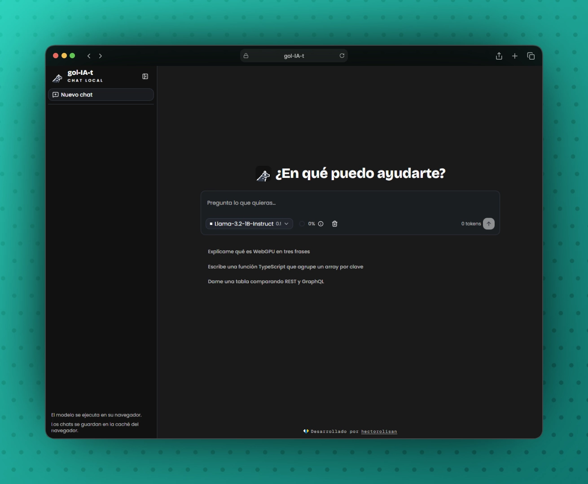

# gol-IA-t

Chat with LLMs that run **100% in the browser** — no server, no API keys.
Models are downloaded once, cached locally and run on the GPU via WebGPU.

- **Next.js 16** — static export (`output: "export"`), no backend.
- **WebLLM** (`@mlc-ai/web-llm`) — in-browser inference on WebGPU, inside a Web Worker.
- **Tailwind CSS 4** + **shadcn/ui** — utility styling and UI components.
- **Streamdown** — streaming Markdown rendering with code highlighting.
- **idb-keyval** — conversations persisted in IndexedDB.
- **pnpm** — package manager.

> Requires a browser with WebGPU (e.g. recent Chrome or Edge).



## Project Structure

```
/
├── public/
│   ├── cover.webp
│   └── goliat.svg              # Logo source
├── src/
│   ├── app/
│   │   ├── globals.css         # @theme tokens + custom utilities
│   │   ├── layout.tsx          # <html>, fonts + metadata
│   │   └── page.tsx            # Renders <ChatApp />
│   ├── components/
│   │   ├── ui/                 # shadcn/ui components
│   │   ├── chat-app.tsx        # Sidebar + conversation layout
│   │   ├── chat-message.tsx    # Message bubble (Markdown, retry, usage)
│   │   ├── composer.tsx        # Prompt input + model selector
│   │   ├── credit.tsx          # Footer credit
│   │   ├── goliat.tsx          # Pixel-art logo
│   │   └── model-info.tsx      # Model, GPU and token usage details
│   ├── hooks/
│   │   ├── use-chat.ts         # Chat state, model loading, streaming
│   │   └── use-mobile.ts
│   └── lib/
│       ├── engine.ts           # Model list (MODEL_IDS) + WebLLM engine
│       ├── engine.worker.ts    # Web Worker running the engine
│       ├── store.ts            # Conversations in IndexedDB
│       └── utils.ts
├── AGENTS.md
├── components.json             # shadcn/ui config
├── LICENSE
├── next.config.ts
├── package.json
└── README.md
```

## Available Scripts

| Command        | Action                                                  |
| :------------- | :------------------------------------------------------ |
| `pnpm install` | Install all dependencies                                |
| `pnpm dev`     | Start dev server at `localhost:3000`                    |
| `pnpm build`   | Build static site into `./out/`, deployable on any host |
| `pnpm lint`    | Run ESLint                                              |

> You can also use `npm` or `bun` if you prefer.
